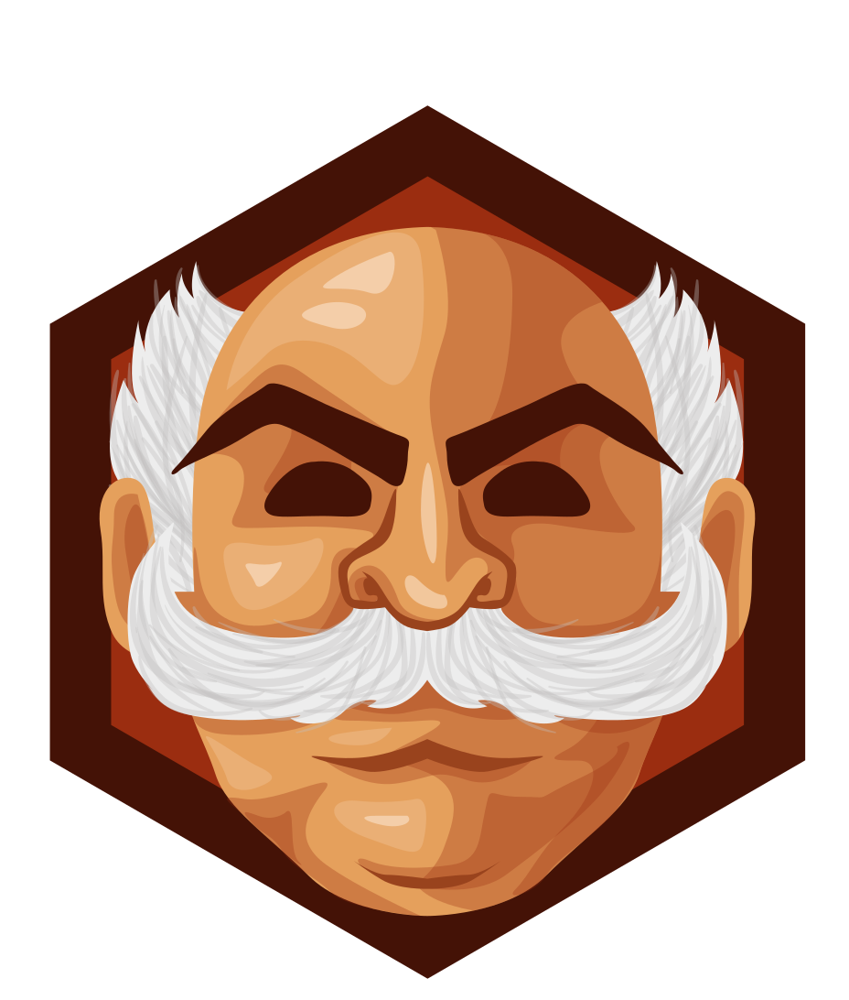
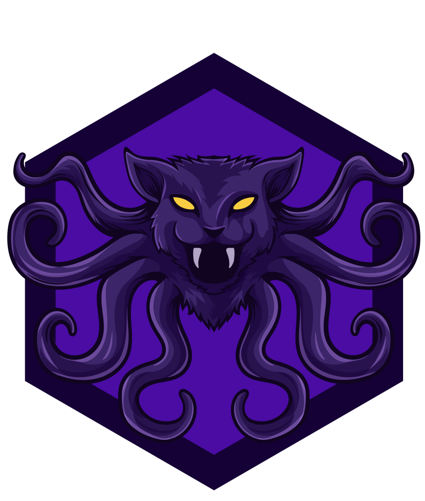
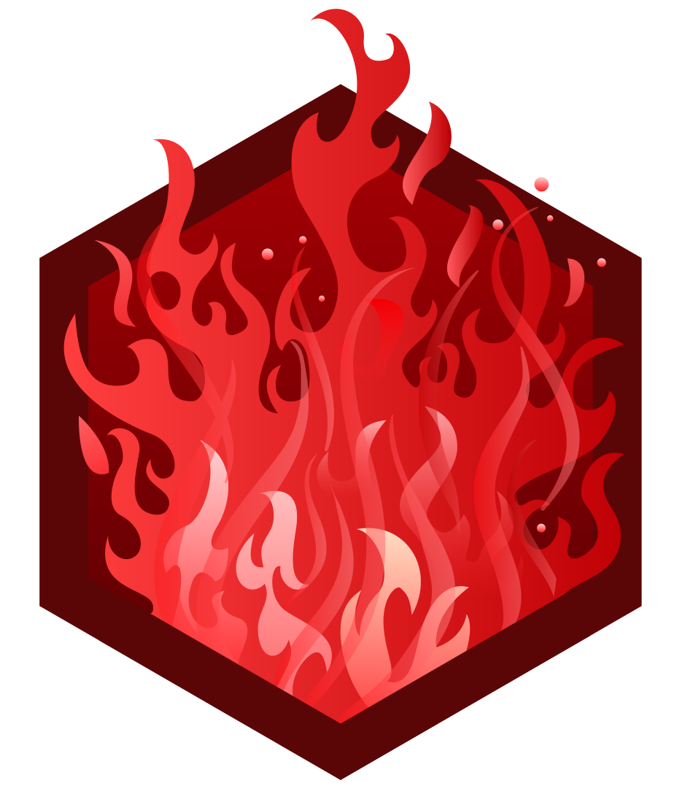
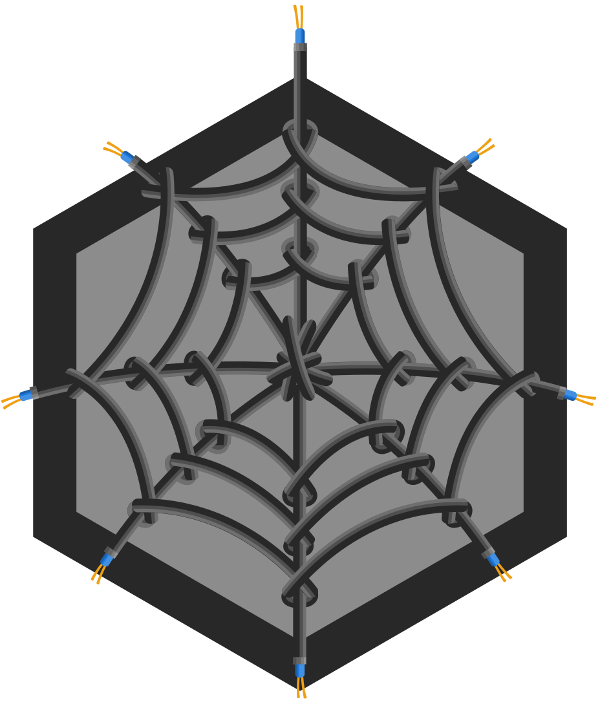
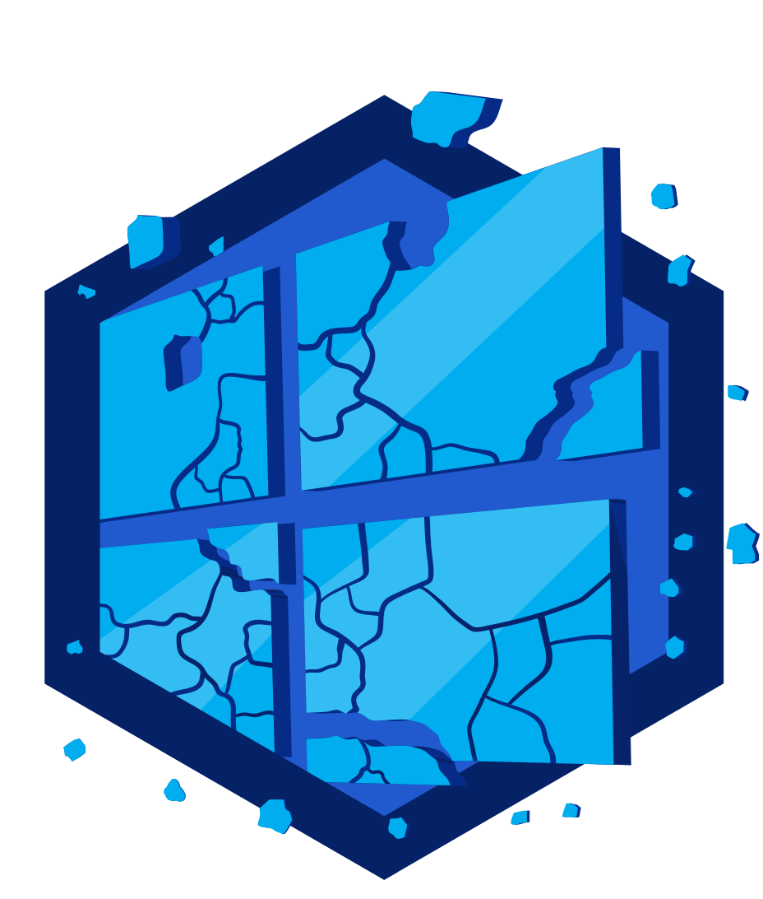
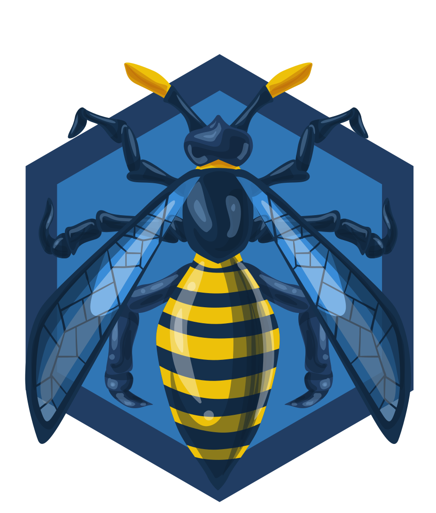

<!-- Heading

  <h1> Hello planet </h1>

 
-->

<!-- Readme stats and top languages -->

  
  

 

<!-- Snake animation -->

  
  

 

<!-- TryHackMe Profile and Badges -->

  <!--  -->
  

  
  
  
  
  
  

  
  
  
  

 

<!-- Linkedin badge

  <a target="_blank" href="https://www.linkedin.com/in/miguel-carvalho-dev">

 
-->

  

